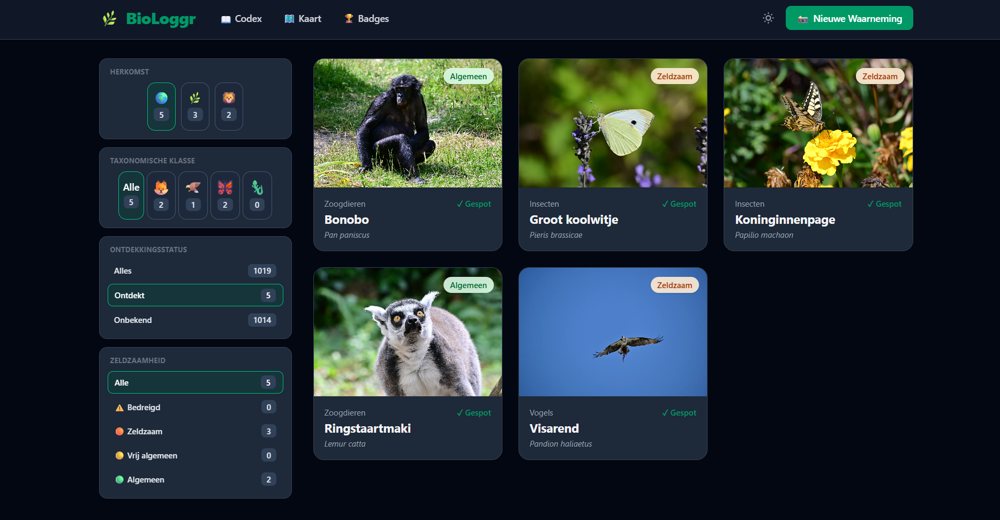
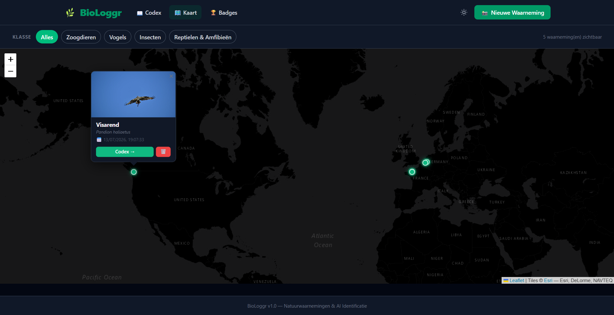
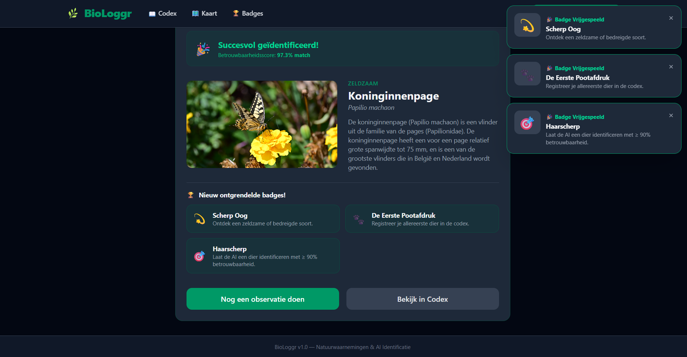
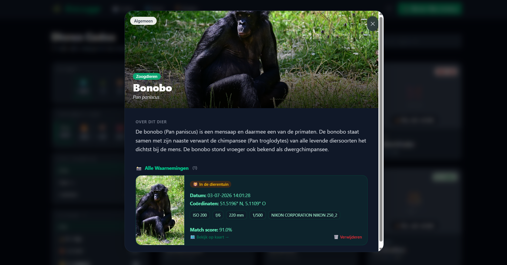
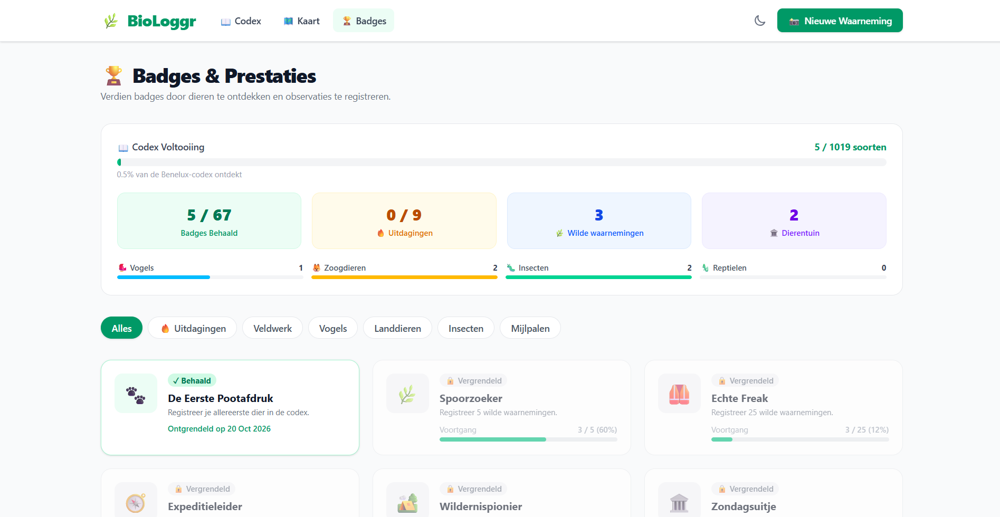

# BioLoggr

<p align="center">
  
  
  
  
  
  
  
</p>

**BioLoggr** is een interactieve natuurgids en persoonlijk waarnemingslogboek. Combineer een rijke dierencodex, AI-beeldherkenning en gamificatie tot één moderne webapp voor natuurliefhebbers, (natuur)fotografen en wandelaars in de Benelux — mét ruimte voor iconische zoodieren.

<p align="center">
  <strong>Codex · Kaart · Observaties · Badges</strong>
</p>

---

## Screenshots

Voorbeelden uit de app (`docs/screenshots/`).

### Dieren Codex

Overzicht met zoekbalk, filters en ontdekte / vergrendelde soorten.



### Interactieve kaart

Waarnemingen als pinpoints op de Leaflet-kaart.



### Waarneming

Uploadpagina met foto, locatie en AI-herkenning.



### Waarneming-modal & EXIF

Detailmodal na een spot: soortinfo, notities en camerametadata (ISO, sluitertijd, toestel, GPS, …).



### Badges & uitdagingen

Overzicht van ontgrendelde badges, voortgang en uitdagingen.



| Bestand | Scherm |
|---------|--------|
| `docs/screenshots/codex.png` | Dieren Codex |
| `docs/screenshots/kaart.png` | Interactieve kaart |
| `docs/screenshots/waarneming.png` | Waarneming / upload |
| `docs/screenshots/modal.png` | Waarneming-modal met EXIF |
| `docs/screenshots/badge.png` | Badges & uitdagingen |

> **Tip:** Houd screenshots bij voorkeur rond **1280 px breed** (PNG of WebP).

---

## Waarom BioLoggr?

| Uitdaging | Oplossing in BioLoggr |
|-----------|------------------------|
| Soorten herkennen op het veld | **BioCLIP**-herkenning op geüploade foto’s, met top-suggesties en betrouwbaarheidsscore |
| Overzicht bewaren | **Codex** met ontdekkingsstatus, filters en biologische detailpagina’s |
| Waar gezien? | **GPS** uit EXIF of browser, zichtbaar op een **interactieve kaart** |
| Blijven verkennen | **67 badges** en **9 uitdagingen** die meegroeien met jouw observaties |

Niet-ontdekte soorten blijven verborgen achter een mysterie-silhouet tot je ze daadwerkelijk registreert — een bewuste incentive om verder te kijken.

---

## Kernfunctionaliteiten

### Dieren Codex — 1019 unieke soorten

De codex bundelt **1019 unieke diersoorten**: wilde dieren uit de **Benelux** en een uitgebreide selectie **zoodieren**. Elke soort heeft Nederlandse en wetenschappelijke naam, taxonomische groepering, zeldzaamheid en een biologisch profiel.

- **Wikipedia-verrijking** — beschrijvingen worden aangevuld via de **Nederlandstalige Wikipedia API** (`backend/enrich_zoo.py`), zodat generieke placeholders vervangen worden door echte biologische teksten.
- **Ontdekkingssysteem** — ontdekte soorten tonen volledige info; niet-ontdekte soorten verschijnen als verduisterde kaarten met slot-indicator.
- **Zoeken & filteren** — realtime zoeken op naam; filter op taxonomische klasse (zoogdieren, vogels, …) en ontdekkingsstatus.
- **Detailpaspoort** — habitat, dieet, afmetingen, voortplanting en bedreigingsstatus via het flexibele `extra_info`-veld.

### AI-beeldherkenning

Upload een foto via drag-and-drop of bestandskiezer. De backend analyseert het beeld met **BioCLIP** (`imageomics/bioclip` via `open_clip`):

- Endpoint **`POST /api/identify`** — top-3 suggesties **zonder** waarneming op te slaan (preview tijdens upload).
- Bij opslaan van een observatie: gebruikerskeuze → BioCLIP → optionele fallback als het model nog laadt.
- Tekst-embeddings voor alle codex-soorten worden **gecacht op schijf** voor snelle inferentie na de eerste model-load.

EXIF-metadata wordt uit het originele bestand gelezen (vóór conversie naar WebP): o.a. **GPS**, opnametijd, **ISO**, diafragma, **sluitertijd**, brandpuntsafstand en cameramodel.

### Gamificatie — 67 badges & 9 uitdagingen

Een dynamische **badge-engine** (`backend/services/badge_service.py`) evalueert al je observaties en ontgrendelt prestaties automatisch. Voortgang en ontgrendelingsdatum worden persistent opgeslagen.

Badges en uitdagingen reageren op o.a.:

| Trigger | Voorbeelden |
|---------|-------------|
| **Locatie (GPS)** | Regio’s, afstand, coördinaten uit EXIF of handmatige invoer |
| **Wild vs. dierentuin** | Vlag `is_wild` per waarneming |
| **Taxonomie** | Zoogdieren, vogels, insecten, amfibieën, … via genus-sets en Nederlandse trefwoorden |
| **EXIF-fotodata** | ISO, sluitertijd, camera/tostel, opnametijdstip |
| **Verzamel- & mijlpaaldoelen** | Eerste spot, zeldzaamheden, volledige categorieën, uitdagingen met meerdere stappen |

Op de **Badges**-pagina zie je ontgrendelde en vergrendelde prestaties, inclusief voortgang waar relevant.

### Moderne, responsieve UI

De frontend is gebouwd met **Angular 22** (standalone components, signals, zoneless change detection) en **Tailwind CSS v4**.

- **Sticky navigatie** met desktop-links en een **mobiel hamburger-menu** (Codex, Kaart, Badges).
- **Donker/licht thema** met systeemvoorkeur.
- **Leaflet-kaart** met waarnemingspinpoints.
- Toegankelijke knoppen en ARIA-labels op kritieke navigatie-elementen.

### Observaties & logboek

- Foto’s worden opgeslagen onder `backend/uploads/` (lokaal) of op een **Modal Volume** in productie, geoptimaliseerd als WebP met thumbnail.
- Waarnemingen bevatten tijdstip, coördinaten, notities, AI-confidence en volledige EXIF-snapshot.
- Overzicht op de kaart en gekoppeld aan codex-detail (alle observaties per soort).

---

## Tech stack

| Laag | Technologie | Rol |
|------|-------------|-----|
| **Frontend** | Angular 22, TypeScript, RxJS | SPA, routing, HTTP-client |
| **Styling** | Tailwind CSS v4 | Responsief design, dark mode |
| **Kaart** | Leaflet | Interactieve waarnemingskaart |
| **EXIF (client)** | exifr | Aanvullende metadata in de browser |
| **Backend** | Python 3.11+, FastAPI, Uvicorn | REST JSON API |
| **Data** | SQLModel, SQLite / [Turso](https://turso.tech) (libSQL) | ORM; lokaal `biologgr.db`, cloud via Turso |
| **Hosting** | [Modal.com](https://modal.com) | Serverless FastAPI + Angular + BioCLIP |
| **Beeld** | Pillow, piexif | Validatie, EXIF, WebP-conversie |
| **AI** | PyTorch, open_clip, BioCLIP | Zero-shot soortidentificatie |
| **Tests** | pytest, Karma/Jasmine, Playwright | Backend-, unit- en e2e-tests |

Backend en frontend zijn **strikt gescheiden**; alle communicatie loopt via REST.

### Architectuur (vereenvoudigd)

```
Biologgr/
├── backend/
│   ├── main.py                 # FastAPI-routes, uploads, EXIF, observaties
│   ├── models.py               # Animal, Observation, Badge, BadgeUnlock
│   ├── database.py             # SQLite-engine & migraties
│   ├── seed.py                 # 1019 soorten uit JSON-seed
│   ├── enrich_zoo.py           # Wikipedia API-verrijking
│   ├── data/                   # species_benelux.json, species_zoo.json, embedding-cache
│   ├── services/
│   │   ├── bioclip_service.py  # BioCLIP-load & predict
│   │   └── badge_service.py    # 67 badges + 9 uitdagingen
│   └── tests/
├── modal_app.py                # Modal deploy: image build, Volume, ASGI
└── frontend/
    └── src/app/
        ├── pages/              # codex, observe, map, badges
        └── services/           # api.service.ts, theme, toast
```

---

## Deployen op Modal.com (aanbevolen)

Productie draait als één **Modal Web App** ([`modal_app.py`](modal_app.py)): de image bouwt de Angular-frontend, installeert FastAPI + **PyTorch CPU** + BioCLIP, en serveert alles via `@modal.asgi_app()`.

| Component | Inrichting |
|-----------|------------|
| **Database** | Turso via secret `biologgr-turso` (`TURSO_DATABASE_URL`, `TURSO_AUTH_TOKEN`) |
| **Foto’s** | Persistent **Modal Volume** `biologgr-images`, gemount op `/app/backend/uploads` — dezelfde map als FastAPI’s `GET /uploads/...` |
| **Codex-seed** | Bij containerstart: [`backend/seed.py`](backend/seed.py) (upsert soorten in Turso) |
| **Static SPA** | Gebouwde Angular-app in `backend/static/` (same-origin API, geen CORS nodig) |

### Eenmalige setup

```powershell
pip install modal
modal token new
```

Turso-secrets (waarden uit je Turso-dashboard; zie [`.env.example`](.env.example)):

```powershell
cd "D:\MyProjects\Eigen projecten\Biologgr"

modal secret create biologgr-turso `
  TURSO_DATABASE_URL="libsql://jouw-db.turso.io" `
  TURSO_AUTH_TOKEN="jouw-token"
```

Bestaande secret overschrijven: voeg `--force` toe. Alternatief: `modal secret create biologgr-turso --from-dotenv .env --force` (alleen lokaal, nooit committen).

### Deploy

```powershell
modal deploy modal_app.py
```

De CLI toont de publieke URL (`https://…--biologgr-web.modal.run`). Lokaal testen met tijdelijke URL: `modal serve modal_app.py`.

> **Eerste deploy:** image-build (npm, PyTorch, BioCLIP-download) kan **20–40 minuten** duren. Daarna zijn uploads persistent op het volume; na elke upload/delete commit [`modal_app.py`](modal_app.py) het volume zodat andere containers de bestanden zien.

Volume handmatig inspecteren: `modal volume ls` en `modal shell --volume biologgr-images`.

---

## Lokaal opstarten

Lokaal draait het project prima (SQLite in `biologgr.db`, frontend op poort 4200, API op 8000). **`pip install -r backend/requirements.txt` trekt PyTorch mee** — op **Windows** kan dat zwaar zijn. Voor dagelijks werk: apart venv; voor productie + AI: **Modal**.

### Database & `.env` (vooral Windows)

Turso (`TURSO_DATABASE_URL` + `TURSO_AUTH_TOKEN`) is bedoeld voor **Modal** (via `modal secret`, niet in de image). **Lokaal op Windows** laat je die variabelen het beste **uit** je `.env`. Zonder Turso valt [`backend/database.py`](backend/database.py) terug op **`biologgr.db`** in de projectroot.

Dat voorkomt dat de **libSQL-driver** (`sqlalchemy-libsql`) lokaal moet bouwen. Zie [`.env.example`](.env.example) als referentie voor Turso-waarden; kopieer die niet blind naar `.env` tenzij je bewust tegen Turso wilt ontwikkelen.

### Vereisten

- **Python** 3.11+
- **Node.js** 20+ en npm
- Voldoende schijfruimte en RAM voor PyTorch + BioCLIP (eerste model-load kan enkele minuten duren)

### 1. Backend

```bash
cd backend
python -m venv venv

# Windows
venv\Scripts\activate

# macOS / Linux
source venv/bin/activate

pip install -r requirements.txt
```

`requirements.txt` bevat FastAPI, SQLModel, Turso-driver (`sqlalchemy-libsql`) en de **AI-dependencies** (`torch`, `torchvision`, `open-clip-torch`, Pillow). Geen aparte BioCLIP-installatiestap meer nodig.

Start de API vanaf de **projectroot**:

```bash
cd ..
uvicorn backend.main:app --reload
```

| URL | Beschrijving |
|-----|----------------|
| http://localhost:8000 | API |
| http://localhost:8000/docs | OpenAPI / Swagger |
| http://localhost:8000/api/health | Status incl. `bioclip`: loading / ready / unavailable |

Bij eerste start worden soorten uit `backend/data/` geseeded wanneer `species_benelux.json` aanwezig is.

### 2. Frontend

```bash
cd frontend
npm install
npm start
```

App: **http://localhost:4200**

### 3. (Optioneel) Wikipedia-verrijking

```bash
python backend/enrich_zoo.py
```

Vult korte of placeholder-beschrijvingen aan met extracts van nl.wikipedia.org.

---

## API-overzicht

| Methode | Pad | Beschrijving |
|---------|-----|----------------|
| `GET` | `/api/health` | Health + BioCLIP-status |
| `POST` | `/api/identify` | AI top-3 op foto (geen opslag) |
| `GET` | `/api/codex` | Alle soorten + laatste observatie |
| `GET` | `/api/codex/{id}` | Detail + alle observaties |
| `POST` | `/api/observations` | Nieuwe waarneming (multipart foto) |
| `GET` | `/api/observations` | Alle waarnemingen |
| `DELETE` | `/api/observations/{id}` | Waarneming verwijderen |
| `GET` | `/api/badges` | Badges met voortgang & unlock-status |
| `GET` | `/api/stats` | Aggregatie voor dashboard/statistieken |

Query-parameter bij observatie: `is_wild` (`true` = in het wild, `false` = dierentuin/opvang).

---

## Datamodel (kern)

```
Animal              Observation           BadgeUnlock
────────            ─────────────       ─────────────
id                  id                  id
scientific_name     animal_id (FK)      badge_id (unique)
dutch_name          latitude            unlocked_at
category            longitude
rarity              image_path
description         timestamp
image_url           confidence
extra_info (JSON)   notes, is_wild
                    iso, aperture, shutter_speed, focal_length,
                    camera_make, camera_model, …
```

Legacy `Badge`-tabel uit vroege seeds; de actieve gamificatie draait op **`BadgeUnlock`** + de registry in `badge_service`.

---

## Kwaliteit & tests

### Backend

```bash
# Vanaf projectroot, venv actief
pytest backend/tests/ -v
```

Integratietests op in-memory SQLite; badge-engine heeft een uitgebreide testsuite in `test_badges.py`.

### Frontend

```bash
cd frontend
npm test          # Karma + Jasmine
npm run build     # Productiebuild
npm run test:e2e  # Playwright
```

---

## Documentatie

| Bestand | Inhoud |
|---------|--------|
| [`SPEC.md`](SPEC.md) | Functionele vereisten, datamodellen, architectuur |
| [`ROADMAP.md`](ROADMAP.md) | Geplande uitbreidingen |
| [`prompts.md`](prompts.md) | Ontwikkelgeschiedenis en mijlpalen |

---

## Roadmap (korte blik)

- Cloudopslag voor foto’s via Cloudflare R2 (Modal Volume dekt productie v1)
- Multi-user accounts en sync
- PostGIS / geavanceerde geo-analyses
- Verdere optimalisatie van BioCLIP-inferentie op GPU

---

<p align="center">
  <sub>Gemaakt voor wie graag buiten kijkt — en het wil onthouden.</sub>
</p>
