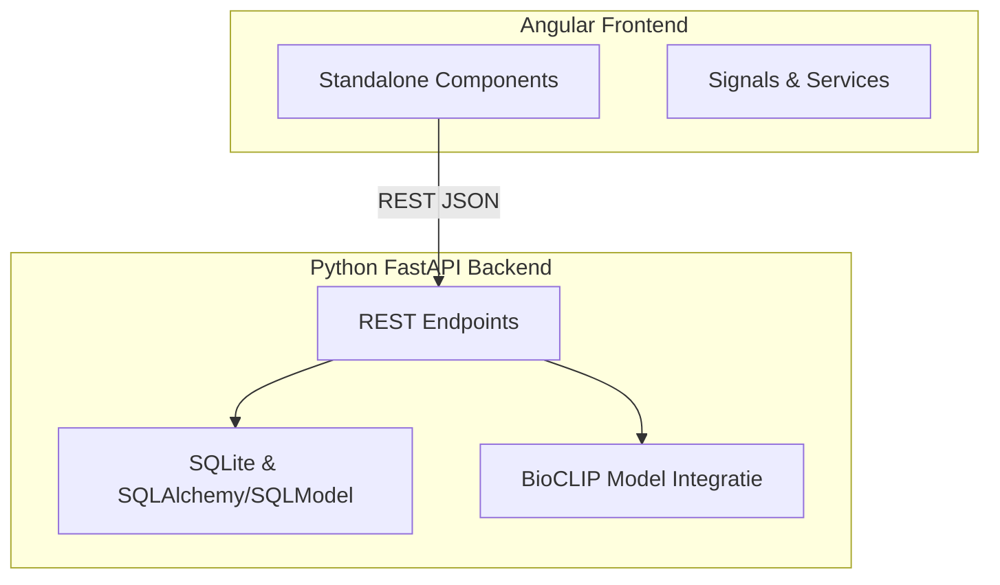

# Architectuur Overzicht en Implementatieplan

## Architectuur Overzicht

De applicatie is opgesplitst in een strikt gescheiden client-server architectuur:

1. **Backend (`/backend`)**:
   - **Framework**: Python 3.11+ met FastAPI.
   - **Database**: SQLite met SQLModel/SQLAlchemy voor eenvoudige ORM-mapping en toekomstige migratie naar PostgreSQL/Supabase.
   - **AI**: Lokale BioCLIP PyTorch modelintegratie voor dieridentificatie op basis van geüploade foto's.
   - **Opslag**: Lokale bestandsopslag voor foto's, ontworpen voor latere migratie naar Cloudflare R2.

2. **Frontend (`/frontend`)**:
   - **Framework**: Angular (Standalone Components, TypeScript, Signals, Tailwind CSS).
   - **Functionaliteit**: Interactieve kaart, dierencodex, foto-uploadformulier, logboek en badgesysteem.

---

## Stappenplan voor de Eerste Bouwsteen

1. **Backend Initialisatie**:
   - Aanmaken van `backend/requirements.txt` met benodigde dependencies (FastAPI, Uvicorn, SQLModel, Pydantic, Pillow, torch, transformers).
   - Aanmaken van `backend/main.py` met basis FastAPI setup en CORS-configuratie.
   - Definiëren van de eerste databasemodellen (`Animal`, `Observation`, `Badge`) in `backend/models.py`.
   - Opzetten van databaseinitialisatie in `backend/database.py`.

2. **Frontend Initialisatie**:
   - Structuur opzetten voor het Angular project binnen `/frontend`.
   - Tailwind CSS configureren en basis layoutcomponenten opzetten.

3. **Verificatie**:
   - Controleren of de backend correct opstart en reageert op health-checks.
